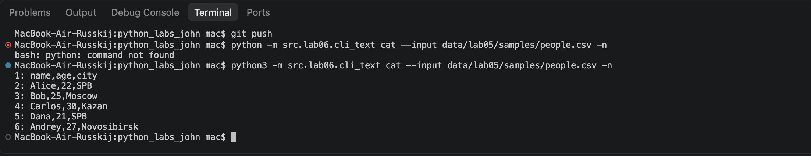
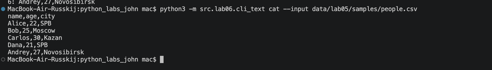
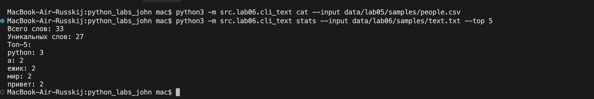
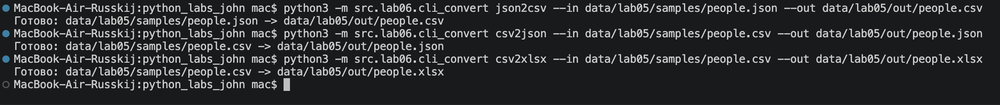

# ЛР6 — CLI-утилиты с argparse (cat/grep-lite + конвертеры)

## Задание A — Текстовые утилиты (`cli_text.py`)

Модуль создаёт консольную утилиту с двумя подкомандами:

- `cat --input <путь> [-n]` — выводит содержимое файла построчно; с флагом `-n` добавляет номер строки.
- `stats --input <путь> [--top N]` — считает частоты слов с помощью функций из ЛР3 (`normalize`, `tokenize`, `count_freq`, `top_n` из `src/lib/text.py`) и печатает общее число слов, число уникальных слов и топ-N (по умолчанию 5).

Файл читается функцией `read_text` из ЛР4 (`src/lab04/io_txt_csv.py`).

Расположен в `src/lab06/cli_text.py`.

## Задание B — Конвертеры (`cli_convert.py`)

Модуль создаёт консольную утилиту с тремя подкомандами: `json2csv`, `csv2json` и `csv2xlsx`.  
У каждой два обязательных параметра: `--in` (входной файл) и `--out` (выходной файл).  
Подкоманды вызывают функции из ЛР5 (`json_to_csv`, `csv_to_json`, `csv_to_xlsx`).

Расположен в `src/lab06/cli_convert.py`.

## Способ запуска

Запуск выполняется **из корня репозитория** (там, где лежит папка `src/`), с помощью флага `-m`:

```bash
python3 -m src.lab06.cli_text <подкоманда> [параметры]
python3 -m src.lab06.cli_convert <подкоманда> [параметры]
```

## Сценарии проверки

### 1. cat — вывод файла с нумерацией

```bash
python3 -m src.lab06.cli_text cat --input data/lab05/samples/people.csv -n
```

Пример вывода:



Без флага `-n`:

```bash
python3 -m src.lab06.cli_text cat --input data/lab05/samples/people.csv
```



### 2. stats — частоты слов

**Вход** (`data/lab06/samples/text.txt`):

```
Привет, мир! Привет, Python!
Python - простой язык, а мир программирования большой.
Мы изучаем Python, чтобы писать простые программы.
По-настоящему интересно, когда программа работает.
Ёлка и ёжик живут в лесу, а ежик любит ёлку.
```

```bash
python3 -m src.lab06.cli_text stats --input data/lab06/samples/text.txt --top 5
```

Пример вывода:



### 3. Конвертеры

```bash
python3 -m src.lab06.cli_convert json2csv --in data/lab05/samples/people.json --out data/lab05/out/people.csv
python3 -m src.lab06.cli_convert csv2json --in data/lab05/samples/people.csv --out data/lab05/out/people.json
python3 -m src.lab06.cli_convert csv2xlsx --in data/lab05/samples/people.csv --out data/lab05/out/people.xlsx
```

Пример вывода:



### 4. Справка `--help`

Справка работает и для самой утилиты, и для каждой подкоманды:

```bash
python3 -m src.lab06.cli_text --help
python3 -m src.lab06.cli_text cat --help
python3 -m src.lab06.cli_text stats --help
python3 -m src.lab06.cli_convert --help
python3 -m src.lab06.cli_convert json2csv --help
```

## Обработка ошибок

- Отсутствие входного файла → понятное сообщение и код выхода 1.
- Некорректный JSON / пустые данные → ValueError с человекочитаемым текстом.
- Неверный `--top` (≤ 0) → `parser.error(...)`.
- Отсутствие `openpyxl` при `csv2xlsx` → RuntimeError с подсказкой по установке.

## Зависимости

- Стандартная библиотека Python (`argparse`, `sys`, `pathlib`, `json`, `csv`).
- Функции из предыдущих лабораторных:
  - `src.lib.text` (ЛР3)
  - `src.lab04.io_txt_csv.read_text` (ЛР4)
  - `src.lab05.json_csv` и `src.lab05.csv_xlsx` (ЛР5)
- Для `csv2xlsx` требуется `openpyxl` (как в ЛР5).
