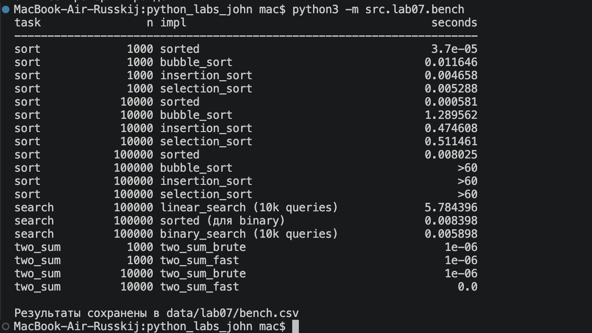

# ЛР7 — Поиск, сортировка и измерение времени

> **Цель:** реализовать базовые алгоритмы поиска и сортировки своими руками,  
> измерить их на разных объёмах данных и увидеть, как число шагов превращается в секунды.  
> Научиться проверять свою функцию сравнением с эталоном.  
> **Связь:** лекции по сложности и алгоритмам поиска/сортировки.  
> Таблицы в CSV — через `write_csv` из ЛР4. Задача Two Sum — оба решения (brute + fast).

---

## Результат

- `src/lab07/search.py` — функции поиска:
  - `linear_search(nums, x) -> int` — индекс первого вхождения или `-1`
  - `binary_search(sorted_nums, x) -> int` — индекс или `-1` (список **уже отсортирован**)
  - `two_sum_brute(nums, target) -> tuple[int, int] | None` — перебор пар
  - `two_sum_fast(nums, target) -> tuple[int, int] | None` — через словарь, один проход
- `src/lab07/sorting.py` — три сортировки (каждая **возвращает новый список**, исходный не меняет):
  - `bubble_sort(nums) -> list` (с ранним выходом ★)
  - `insertion_sort(nums) -> list`
  - `selection_sort(nums) -> list`
- `src/lab07/check.py` — проверка против эталона на случайных данных
- `src/lab07/bench.py` — замеры через `timeit`, таблица в консоль + `data/lab07/bench.csv`
- Данные: `data/lab07/bench.csv` (колонки: `task,n,impl,seconds`)

Только стандартная библиотека + `write_csv` из ЛР4.

---

## Структура

```
python_labs/
├─ src/
│  ├─ lab04/
│  │  └── io_txt_csv.py        # write_csv, ensure_parent_dir (ЛР4)
│  └─ lab07/
│     ├── search.py
│     ├── sorting.py
│     ├── check.py
│     ├── bench.py
│     ├── __init__.py
│     └── README.md
├─ data/
│  └─ lab07/
│     └── bench.csv            # появляется после запуска bench
└─ images/
   └─ lab07/
      ├── check.png
      └── bench.png
```

---

## Запуск (из корня репозитория)

### Проверка корректности

```bash
python3 -m src.lab07.check
```

Ожидаемый вывод:

```
OK: все проверки пройдены
```


### Бенчмарк

```bash
python3 -m src.lab07.bench
```

Выводит таблицу в консоль и сохраняет результаты в `data/lab07/bench.csv`.



---

## Описание функций

### A. Поиск (`search.py`)

#### `linear_search(nums, x)`
- Идёт по списку слева направо.
- Возвращает индекс **первого** вхождения `x` или `-1`.
- Не требует отсортированных данных.

```python
linear_search([4, 2, 7, 2], 2)  # → 1
linear_search([4, 2, 7, 2], 9)  # → -1
linear_search([], 1)            # → -1
```

#### `binary_search(sorted_nums, x)`
- Работает **только** на отсортированном по возрастанию списке.
- На неотсортированном списке результат не определён.
- Возвращает индекс любого вхождения `x` или `-1`.
- Цикл `while lo <= hi`.

```python
binary_search([1, 3, 5, 7], 5)  # → 2
binary_search([1, 3, 5, 7], 4)  # → -1
binary_search([5], 5)           # → 0
binary_search([], 5)            # → -1
```

#### `two_sum_brute(nums, target)`
- Два вложенных цикла, сложность O(n²).
- Возвращает пару индексов `(i, j)` где `i < j` и `nums[i] + nums[j] == target`, или `None`.

```python
two_sum_brute([2, 7, 11, 15], 9)  # → (0, 1)
two_sum_brute([1, 2], 10)         # → None
```

#### `two_sum_fast(nums, target)`
- Один проход со словарём «значение → индекс», сложность O(n).
- При нескольких возможных ответах допустим любой.

```python
two_sum_fast([2, 7, 11, 15], 9)  # → (0, 1)
```

---

### B. Сортировки (`sorting.py`)

Все три функции:
- принимают список;
- **возвращают новый** отсортированный список;
- **не меняют** исходный (проверяется в `check.py`);
- корректно работают на пустом списке и списке из одного элемента;
- **без** `sorted`, `.sort()`, `min`, `max` и других готовых функций.

#### `bubble_sort`
- Проходим по списку, меняем соседние элементы местами, если они стоят не по порядку.
- За один проход максимум «всплывает» в конец.
- ★ Ранний выход: если за проход не было ни одного обмена — список уже отсортирован.

#### `insertion_sort`
- Берём очередной элемент и сдвигаем его влево, пока он не встанет на своё место.
- На почти отсортированных данных почти линейна.

#### `selection_sort`
- Находим минимум оставшейся части и ставим на текущую позицию.
- Всегда делает ~n²/2 сравнений.

```python
bubble_sort([3, 1, 2])   # → [1, 2, 3]
insertion_sort([2, 2, 1]) # → [1, 2, 2]
selection_sort([])        # → []
```

---

### C. Проверка (`check.py`)

- `check_sorting(fn, trials=100)` — случайные списки длиной 0–50, значения −100…100;  
  `assert fn(nums) == sorted(nums)` + проверка, что исходный список не изменился.
- `check_search(trials=100)` — `linear_search` против `list.index`;  
  `binary_search` — на отсортированных (включая отсутствующий элемент и крайние).
- `check_two_sum(trials=100)` — оба способа дают пару с нужной суммой или оба `None`.

При расхождении — `AssertionError` с данными, на которых разошлось.

```bash
python3 -m src.lab07.check
# OK: все проверки пройдены
```

---

### D. Бенчмарк (`bench.py`)

- Одни и те же случайные данные для всех алгоритмов (`random.seed(42)`).
- **Сортировки:** `n = 1_000 / 10_000 / 100_000`  
  Квадратичные на 100 000 помечены `>60` (слишком долго).
- **Поиск:** список из 100 000, 10 000 случайных запросов;  
  для бинарного — отдельно время предварительной сортировки.
- **Two Sum:** `n = 1_000 / 10_000`, target гарантированно существует.
- Вывод — таблицей в консоль + запись в `data/lab07/bench.csv` через `write_csv` из ЛР4.

---

## Таблица бенчмарка

(после запуска `python3 -m src.lab07.bench` вставь сюда содержимое CSV или оставь скрин)

| task    | n      | impl                           | seconds |
|---------|--------|--------------------------------|---------|
| sort    | 1000   | sorted                         | …       |
| sort    | 1000   | bubble_sort                    | …       |
| sort    | 1000   | insertion_sort                 | …       |
| sort    | 1000   | selection_sort                 | …       |
| sort    | 10000  | sorted                         | …       |
| …       | …      | …                              | …       |
| search  | 100000 | linear_search (10k queries)    | …       |
| search  | 100000 | sorted (для binary)            | …       |
| search  | 100000 | binary_search (10k queries)    | …       |
| two_sum | 1000   | two_sum_brute                  | …       |
| two_sum | 1000   | two_sum_fast                   | …       |
| two_sum | 10000  | two_sum_brute                  | …       |
| two_sum | 10000  | two_sum_fast                   | …       |

---

## Выводы

**Почему пузырёк при росте n в 10 раз замедляется примерно в 100 раз, а `sorted` — в ~12–15**

Пузырьковая (и selection/insertion) сортировка имеет сложность **O(n²)**.  
При увеличении размера данных в 10 раз количество операций растёт в **100 раз** (10²) — поэтому время тоже растёт примерно в 100 раз.  

`sorted` (Timsort) имеет сложность **O(n log n)**. При росте n в 10 раз `log n` увеличивается незначительно, поэтому общее время растёт примерно в 10–15 раз, а не в 100. Это хорошо видно в таблице бенчмарка.

**Почему бинарный поиск бесполезен без предварительной сортировки, и когда она окупается**

Бинарный поиск работает **только** на уже отсортированном массиве: на каждом шаге он отбрасывает половину элементов (O(log n)).  
На неотсортированных данных результат не определён.  

Если нужно сделать **один** поиск — дешевле просто пройтись линейно (O(n)).  
Если запросов много (тысячи и больше), выгоднее один раз отсортировать (O(n log n)) и потом быстро отвечать за O(log n) на каждый запрос.  
В бенчмарке 10 000 бинарных поисков на уже отсортированном списке из 100 000 элементов заметно быстрее, чем 10 000 линейных.

**Что показал `check.py`**

Прогнано по 100 случайных тестов для каждой из трёх сортировок, для поиска и для two_sum.  
Все проверки прошли без `AssertionError`. Исходные списки после сортировок не изменяются.  
Расхождений не найдено.

---

## Зависимости

- Стандартная библиотека Python (`timeit`, `random`, `pathlib`)
- `src.lab04.io_txt_csv.write_csv` (ЛР4) — для записи `bench.csv`
